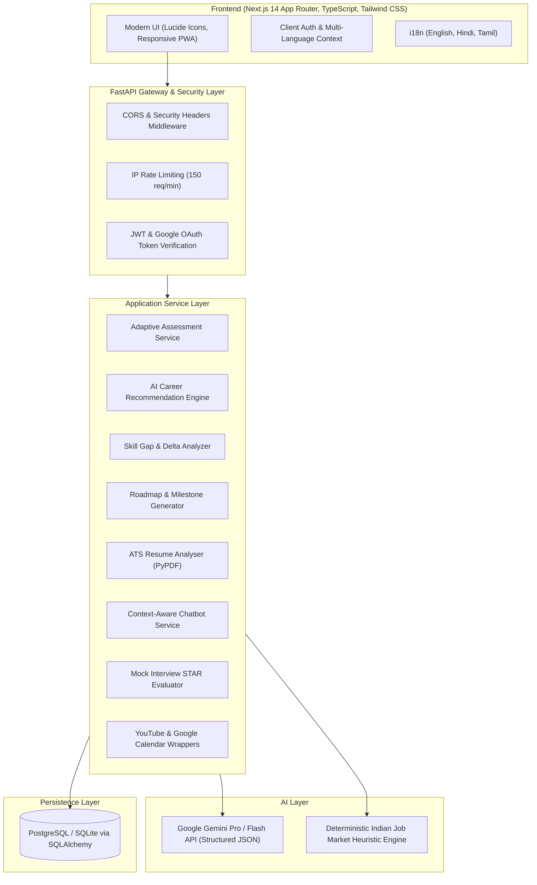
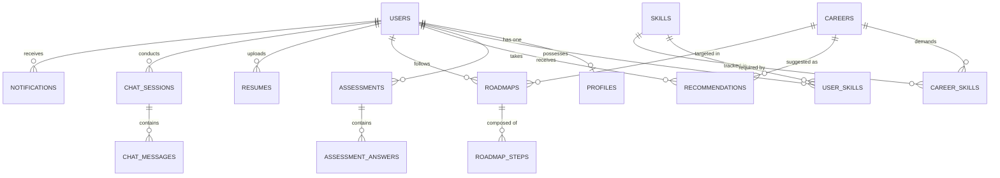

# PathFinder AI 🚀
### AI Enhanced Career Guidance System for Indian Students & Job Seekers

[](https://fastapi.tiangolo.com)
[](https://nextjs.org)
[](https://python.org)
[](https://www.typescriptlang.org)
[](https://tailwindcss.com)
[](LICENSE)

---

## 📌 Problem & Vision
Students and job seekers across India encounter confusing choices, outdated guidance, and expensive commercial counseling bootcamps:
- **Class 10-12 Students** struggle to choose between PCM, PCB, Commerce, and Arts with no insight into real-world salaries.
- **College & Engineering Students** face tier-2/3 placement hurdles without clear project requirements or interview guidance.
- **Career Switchers** lack a transparent understanding of their skill gaps when transitioning into high-demand roles.

**PathFinder AI** solves this by providing a completely free, explainable, and personalized career acceleration system that reveals:
1. **Which Career Fits You**: Calculated through an adaptive RIASEC and problem-solving quiz.
2. **Which Skills You Are Missing**: Visualized via an interactive Skill Gap Radar benchmarked against real Indian job market standards.
3. **Exactly What To Do Next**: A structured 12-week roadmap with curated, 100% free learning resources (YouTube, official documentation, capstone projects), ATS resume scoring, and mock AI interview practice.

---

## 🏗️ Architecture & Workflow



---

## 📊 Database Schema (ER Diagram)

The system is powered by 16 relational entities supporting full auditability, user progress tracking, and role-based access:



---

## ✨ Features Checklist

### Core MVP
- [x] **Authentication & Role-Based Access**: Email/password registration, login, and Google OAuth / Firebase compatibility. Role-based scopes (`user` vs `admin`).
- [x] **Step-by-Step Onboarding**: Customizes path based on education level (Class 10, Class 12, Engineering, Graduate, Switcher) and stream.
- [x] **Adaptive Career Assessment**: 15 multi-dimensional questions analyzing problem-solving instinct, risk tolerance, and RIASEC traits with automatic progress save/resume.
- [x] **AI Career Recommendations**: Top 5 career matches with match percentage, Indian salary bands in INR, confidence score, and explainable "Why this fits you" reasoning.
- [x] **Skill Gap Analyser**: Compares user proficiency against target role prerequisites. Displays gaps and readiness levels.
- [x] **Personalised 12-Week Roadmap**: Weekly timeline with curated free YouTube masterclasses, documentation, project deliverables, and tick-off progress tracking.
- [x] **ATS Resume Analyser**: PDF upload and parsing via `pypdf`, providing ATS score (0-100), section scores, missing keywords, and actionable fixes.
- [x] **AI Career Chatbot**: Context-aware 24/7 counselor equipped with the student's profile, stream background, and active roadmap milestones.
- [x] **Student Dashboard**: Streaks counter, milestone badges unlocked, progress gauges, and real-time "Next Best Action" guidance.

### Advanced Differentiators
- [x] **Multilingual UI**: Seamless instant language toggle between English, Hindi (हिंदी), and Tamil (தமிழ்).
- [x] **Mock Interview Practice**: Technical, behavioral, and situational practice questions with AI scoring and STAR model feedback.
- [x] **Career Comparison**: Side-by-side comparative analysis of 2 to 3 target careers (salaries, demand level, growth outlook, prerequisites).
- [x] **Exams & Scholarships Finder**: Tracks JEE, GATE, CAT, UPSC, National Overseas Scholarship, PMRF, and AICTE Pragati with 1-click Google Calendar sync and email reminders.
- [x] **Admin Portal**: Platform metrics dashboard, catalog seed status, and career management tools.
- [x] **Digital Privacy & DPDP Act Compliance**: 1-click machine-readable JSON data export and permanent deletion controls.

---

## 💼 Seed Data: 26 Real Indian Careers

The database seeds with 26 authentic, in-demand careers mapped to actual Indian industry salary bands and skills:
1. **Full Stack Web Developer** (5-8 LPA Entry • 14-24 LPA Mid • 32-55+ LPA Senior)
2. **Data Scientist & Machine Learning Engineer** (6-10 LPA • 18-30 LPA • 40-75+ LPA)
3. **Cloud & DevOps Solutions Architect** (6-9 LPA • 16-28 LPA • 35-65+ LPA)
4. **Cybersecurity & InfoSec Analyst** (5-8 LPA • 14-25 LPA • 30-55+ LPA)
5. **Mobile Application Developer (Flutter & React Native)** (4.5-7.5 LPA • 13-22 LPA • 28-48+ LPA)
6. **Embedded Systems & IoT Engineer** (4-7 LPA • 11-20 LPA • 24-42+ LPA)
7. **UI/UX & Digital Product Designer** (4.5-8 LPA • 12-22 LPA • 26-45+ LPA)
8. **Technical Product Manager (TPM / PM)** (8-14 LPA • 20-35 LPA • 45-80+ LPA)
9. **Data Analyst & BI Specialist** (4-7 LPA • 10-18 LPA • 22-38+ LPA)
10. **Chartered Accountant & Financial Analyst** (8-12 LPA • 18-32 LPA • 40-80+ LPA)
11. **Investment Banking & Private Equity Analyst** (12-20 LPA • 28-50 LPA • 60-120+ LPA)
12. **Digital Marketing & Growth Lead** (3.5-6.5 LPA • 10-18 LPA • 22-40+ LPA)
13. **AI & NLP Research Scientist** (12-22 LPA • 30-55 LPA • 65-110+ LPA)
14. **Blockchain & Smart Contract Developer** (6-10 LPA • 16-30 LPA • 35-65+ LPA)
15. **Civil Infrastructure & Smart City Engineer** (3.5-6 LPA • 9-16 LPA • 20-38+ LPA)
16. **Electric Vehicle (EV) Powertrain & Battery Engineer** (4.5-8 LPA • 12-22 LPA • 25-45+ LPA)
17. **Bioinformatics & Computational Genomics Specialist** (4-7 LPA • 11-19 LPA • 22-40+ LPA)
18. **Corporate Lawyer & Legal Tech Consultant** (5-10 LPA • 14-26 LPA • 32-60+ LPA)
19. **Human Resource Business Partner (HRBP)** (4.5-7.5 LPA • 12-20 LPA • 25-45+ LPA)
20. **Supply Chain & Logistics Operations Manager** (5-8.5 LPA • 13-22 LPA • 26-50+ LPA)
21. **Renewable Energy & Solar Systems Engineer** (4-6.5 LPA • 10-18 LPA • 22-40+ LPA)
22. **Game Developer & 3D Interactive Artist** (4-7 LPA • 11-20 LPA • 24-42+ LPA)
23. **HealthTech & Clinical Informatics Specialist** (4.5-8 LPA • 12-21 LPA • 25-46+ LPA)
24. **Civil Services & Public Administration Officer (UPSC)** (Pay Level 10-14 + Perks)
25. **Software QA & Automation Test Lead** (4-6.5 LPA • 10-18 LPA • 22-38+ LPA)
26. **Quantitative Finance & Algorithmic Trading Developer** (18-35 LPA • 45-80 LPA • 90-180+ LPA)

---

## 🛠️ Tech Stack & Integrations

| Tier | Technologies |
|---|---|
| **Frontend** | Next.js 14 (App Router), TypeScript, Tailwind CSS, Lucide React, Recharts |
| **Backend** | FastAPI, Python 3.11, Pydantic v2, SQLAlchemy 2.0, PyPDF, APScheduler |
| **Database** | PostgreSQL (Neon / Supabase ready), SQLite zero-config local fallback |
| **AI Integration** | Google Gemini API (Structured JSON Schema) + Deterministic Heuristic Engine |
| **Authentication** | JWT (HS256) + Google OAuth / Firebase token verification |
| **Integrations** | YouTube Data API v3, Google Calendar API, Resend / SMTP Email, Sentry |

---

## 🚀 Quick Start Guide

### 1. Prerequisites
- Python 3.11+
- Node.js 18+ & npm

### 2. Backend Setup
```bash
# Clone the repository
git clone https://github.com/your-username/pathfinder-ai.git
cd pathfinder-ai

# Create and activate virtual environment
python -m venv .venv
source .venv/bin/activate  # On Windows: .venv\Scripts\activate

# Install backend dependencies
pip install -r backend/requirements.txt

# Configure environment variables
cp backend/.env.example backend/.env

# Run FastAPI backend server (Auto-seeds database on startup)
cd backend
python -m uvicorn app.main:app --host 0.0.0.0 --port 8000 --reload
```
Backend API will be live at `http://localhost:8000`.
OpenAPI documentation is available at `http://localhost:8000/docs`.

### 3. Frontend Setup
```bash
# In a new terminal tab:
cd frontend

# Install frontend dependencies
npm install

# Start Next.js development server
npm run dev
```
Open `http://localhost:3005` in your browser.

---

## 🐳 Docker Deployment

Run the complete multi-container system (PostgreSQL + FastAPI Backend + Next.js Frontend) using Docker Compose:

```bash
docker compose up --build
```
- Frontend: `http://localhost:3005`
- Backend API: `http://localhost:8000`
- PostgreSQL: `localhost:5432`

---

## 🧪 Testing

Execute automated backend tests covering authentication, assessment flow, recommendations, roadmap generation, and ATS analysis:

```bash
# Run pytest suite
pytest backend/tests -v
```

---

## 🛡️ Responsible AI & Ethical Guardrails
- **No False Guarantees**: PathFinder AI explicitly states that algorithmic predictions are probabilistic recommendations based on aptitude signals and Indian hiring trends, never absolute guarantees of employment or salary.
- **Explainability**: Every recommendation includes a confidence level and transparent pros and cons.
- **Fail-Safe Fallbacks**: If external AI APIs experience outages or rate limits, the built-in deterministic heuristic engine seamlessly provides accurate guidance without service interruption.

---

## 📄 License
This project is open-source and licensed under the [MIT License](LICENSE).

