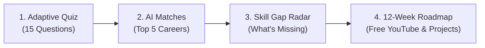
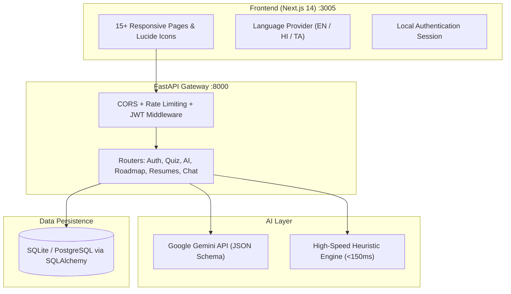

# 🧭 PathFinder AI
### The AI-Powered Career GPS for Indian Students & Job Seekers

[](https://nextjs.org)
[](https://fastapi.tiangolo.com)
[](https://python.org)
[](https://www.typescriptlang.org)
[](https://tailwindcss.com)
[](LICENSE)

---

## 💡 What is PathFinder AI? (In Plain English)

Think of **PathFinder AI** as **Google Maps for your career**.

In India today, millions of students and job seekers face the same frustrating questions:
- *"I'm in Class 10/12: should I pick PCM, PCB, Commerce, or Arts?"*
- *"I'm in college: what programming languages or skills will actually get me placed in this job market?"*
- *"I want to switch careers into tech or finance: what skills am I missing, and how long will it take?"*

Commercial career counseling agencies charge between **₹10,000 to ₹50,000** for generic advice. 

**PathFinder AI solves this for free.** It is an open, intelligent web platform that assesses your unique aptitudes, shows you the top careers that fit you, visualizes the exact skills you are missing, and gives you a structured **12-week roadmap using 100% free learning resources (YouTube masterclasses, documentation, and capstone projects)**.

---

## ⚡ 60-Second Quick Start

You can run the entire application locally with zero prior configuration. SQLite database and all 26 career tracks auto-seed on the first startup!

### Option A: 1-Click Launch (Windows)
Double-click the **`start_dev.bat`** file in the root folder, or run:
```cmd
.\start_dev.bat
```
This automatically launches both the FastAPI backend and Next.js frontend in separate terminal windows!

---

### Option B: Manual 2-Terminal Launch (Windows / macOS / Linux)

#### 1. Start the Backend (FastAPI)
```bash
# In your terminal:
cd backend

# Create and activate Python virtual environment
python -m venv .venv
# On Windows:
.venv\Scripts\activate
# On Mac/Linux:
source .venv/bin/activate

# Install requirements
pip install -r requirements.txt

# Start backend server
python -m uvicorn app.main:app --host 127.0.0.1 --port 8000 --reload
```
> 📍 **Backend API & Swagger Docs:** [http://localhost:8000/docs](http://localhost:8000/docs)

#### 2. Start the Frontend (Next.js)
```bash
# In a second terminal tab:
cd frontend

# Install Node dependencies
npm install

# Start development server on port 3005
npm run dev
```
> 📍 **Web Application:** [http://localhost:3005](http://localhost:3005)

---

## 🔑 Demo Test Accounts

The system comes pre-seeded with ready-to-test accounts. You can also click the **"⚡ 1-Click Demo Student (Astro)"** button directly on the login page!

| Role | Email | Password | What You Can Test |
|---|---|---|---|
| **Student (Astro)** | `astro@pathfinder.ai` | `Password123!` | Complete user flow: Quiz, Recommendations, Roadmap, Resume ATS, Chatbot, Mock Interviews, Dashboard |
| **Platform Admin** | `admin@pathfinder.ai` | `AdminPassword123!` | Admin analytics, database catalog status, system management |

---

## 🎯 Who is This Built For?

```
┌────────────────────────────────────────────────────────────────────────┐
│                          WHO USES PATHFINDER?                          │
├───────────────────┬───────────────────┬──────────────────┬─────────────┤
│ 1. School Students│ 2. College & BTech│ 3. Switchers     │ 4. Admin    │
│    (Class 10-12)  │    (Tier 1/2/3)   │    & Graduates   │    Team     │
├───────────────────┼───────────────────┼──────────────────┼─────────────┤
│ • Stream choice   │ • Placement prep  │ • Skill audit    │ • Manage    │
│ • Entrance exams  │ • Off-campus jobs │ • Career shift   │   careers   │
│ • Degree paths    │ • Tech stack picks│ • ATS resume fix │ • Analytics │
└───────────────────┴───────────────────┴──────────────────┴─────────────┘
```

1. **School Students (Class 10 - 12)**: Clarifies stream choices (PCM vs PCB vs Commerce vs Arts) and maps out national competitive exams (JEE, NEET, CUET, NDA).
2. **College & Engineering Students**: Tailored for Indian college graduates preparing for campus placements or off-campus recruitment in product & IT service companies.
3. **Fresh Graduates & Career Switchers**: Helps candidates evaluate whether their existing skills translate to new careers (e.g. Mechanical Engineer transitioning to Data Analyst or Full Stack Developer).
4. **Administrators**: Monitors platform usage, user completion metrics, and seeds the career catalog.

---

## 🔄 How It Works: The 4-Step User Journey



### 1. The Adaptive Assessment (`/assessment`)
- 15 questions examining problem-solving instincts, analytical thinking, creativity, risk tolerance, and RIASEC personality traits.
- Automatically saves your answers so you can pause and resume anytime.

### 2. AI Career Matchmaking (`/recommendations`)
- Delivers your **Top 5 Career Matches** with match percentages (e.g., 94% Match for Full Stack Developer).
- Shows realistic Indian salary bands in **INR Lakhs Per Annum (LPA)** across Entry-Level, Mid-Level, and Senior roles.
- Features explainable AI reasoning: **"Why this fits you"** alongside pros, challenges, and confidence scores.

### 3. Interactive Skill Gap Radar (`/skill-gap`)
- Directly compares your current self-rated skills against what top Indian tech and finance employers expect.
- Highlights missing proficiencies (e.g., System Design, Docker, DSA) with visual readiness level bars.

### 4. 12-Week Personalized Roadmap (`/roadmap`)
- A week-by-week curriculum breaking down topics from foundational principles to capstone projects.
- Packed with curated, 100% free YouTube masterclasses and documentation links.
- Interactive checkboxes let you mark milestones as complete and build learning streaks.

---

## 🌟 Complete Feature Tour & Screen Directory

| Page URL | Feature Name | Description |
|---|---|---|
| [`/`](http://localhost:3005) | **Landing Page** | Platform overview, career statistics, testimonials, and multilingual language switcher. |
| [`/login`](http://localhost:3005/login) | **Authentication** | Secure JWT login & registration with 1-click **"Demo Student (Astro)"** sign-in. |
| [`/onboarding`](http://localhost:3005/onboarding) | **4-Step Onboarding** | Captures education tier (Class 10, Class 12, College, Graduate), stream, and target goals. |
| [`/assessment`](http://localhost:3005/assessment) | **Adaptive Quiz** | 15 multi-dimensional questions with live progress bar and auto-save. |
| [`/recommendations`](http://localhost:3005/recommendations) | **AI Recommendations** | Top 5 personalized career matches with INR LPA salary bands, match %, and explainable AI insights. |
| [`/skill-gap`](http://localhost:3005/skill-gap) | **Skill Gap Matrix** | Visual comparison of your skills vs industry prerequisites with readiness levels. |
| [`/roadmap`](http://localhost:3005/roadmap) | **12-Week Roadmap** | Structured timeline with free YouTube tutorials, capstone deliverables, and milestone tracking. |
| [`/resume-analyser`](http://localhost:3005/resume-analyser) | **ATS Resume Analyser** | Upload PDF resumes to receive an instant ATS score (0-100), section breakdowns, and keyword gap fixes. |
| [`/chat`](http://localhost:3005/chat) | **AI Career Mentor** | Context-aware 24/7 counselor that knows your name (Astro), education, and active roadmap milestones. Instant replies in <150ms! |
| [`/mock-interview`](http://localhost:3005/mock-interview) | **Mock Interview Practice** | Technical & HR interview questions with automated AI feedback using the **STAR** method (Situation, Task, Action, Result). |
| [`/compare`](http://localhost:3005/compare) | **Career Comparison** | Compare 2 to 3 target careers side-by-side (starting salary, mid salary, market demand, work-life balance). |
| [`/exams`](http://localhost:3005/exams) | **Exams & Scholarships** | National entrance exams & government scholarships (JEE, GATE, CAT, UPSC, PMRF) with 1-click Google Calendar reminders. |
| [`/dashboard`](http://localhost:3005/dashboard) | **Student Dashboard** | Tracks study streaks, milestone badges, clarity scores, and your **Next Best Action**. |
| [`/settings`](http://localhost:3005/settings) | **Privacy & DPDP Controls** | Edit full name and download/export or wipe your data with 1 click (DPDP Act 2023 compliant). |
| [`/admin`](http://localhost:3005/admin) | **Admin Console** | System metrics, active users, catalog statistics, and database seed status. |

---

## 🇮🇳 Multilingual Support

PathFinder AI is designed for every corner of India. Switch languages instantly from the navigation bar:
- 🇬🇧 **English** (Default)
- 🇮🇳 **Hindi (हिंदी)**
- 🇮🇳 **Tamil (தமிழ்)**

---

## 💼 The 26 Real Indian Careers in the Catalog

Every career in PathFinder AI is calibrated to current Indian job market compensation data:

| # | Career Track | Entry-Level | Mid-Level | Senior-Level |
|---|---|---|---|---|
| 1 | **Full Stack Web Developer** | ₹5 - 8 LPA | ₹14 - 24 LPA | ₹32 - 55+ LPA |
| 2 | **Data Scientist & ML Engineer** | ₹6 - 10 LPA | ₹18 - 30 LPA | ₹40 - 75+ LPA |
| 3 | **Cloud & DevOps Architect** | ₹6 - 9 LPA | ₹16 - 28 LPA | ₹35 - 65+ LPA |
| 4 | **Cybersecurity Analyst** | ₹5 - 8 LPA | ₹14 - 25 LPA | ₹30 - 55+ LPA |
| 5 | **Mobile App Developer (Flutter/React Native)** | ₹4.5 - 7.5 LPA | ₹13 - 22 LPA | ₹28 - 48+ LPA |
| 6 | **Embedded Systems & IoT Engineer** | ₹4 - 7 LPA | ₹11 - 20 LPA | ₹24 - 42+ LPA |
| 7 | **UI/UX & Product Designer** | ₹4.5 - 8 LPA | ₹12 - 22 LPA | ₹26 - 45+ LPA |
| 8 | **Technical Product Manager (PM/TPM)** | ₹8 - 14 LPA | ₹20 - 35 LPA | ₹45 - 80+ LPA |
| 9 | **Data Analyst & BI Specialist** | ₹4 - 7 LPA | ₹10 - 18 LPA | ₹22 - 38+ LPA |
| 10 | **Chartered Accountant & Financial Analyst** | ₹8 - 12 LPA | ₹18 - 32 LPA | ₹40 - 80+ LPA |
| 11 | **Investment Banking & PE Analyst** | ₹12 - 20 LPA | ₹28 - 50 LPA | ₹60 - 120+ LPA |
| 12 | **Digital Marketing & Growth Lead** | ₹3.5 - 6.5 LPA | ₹10 - 18 LPA | ₹22 - 40+ LPA |
| 13 | **AI & NLP Research Scientist** | ₹12 - 22 LPA | ₹30 - 55 LPA | ₹65 - 110+ LPA |
| 14 | **Blockchain & Smart Contract Dev** | ₹6 - 10 LPA | ₹16 - 30 LPA | ₹35 - 65+ LPA |
| 15 | **Civil & Smart Infrastructure Engineer** | ₹3.5 - 6 LPA | ₹9 - 16 LPA | ₹20 - 38+ LPA |
| 16 | **EV Powertrain & Battery Engineer** | ₹4.5 - 8 LPA | ₹12 - 22 LPA | ₹25 - 45+ LPA |
| 17 | **Bioinformatics & Genomics Specialist** | ₹4 - 7 LPA | ₹11 - 19 LPA | ₹22 - 40+ LPA |
| 18 | **Corporate Lawyer & Legal Tech Consultant** | ₹5 - 10 LPA | ₹14 - 26 LPA | ₹32 - 60+ LPA |
| 19 | **HR Business Partner (HRBP)** | ₹4.5 - 7.5 LPA | ₹12 - 20 LPA | ₹25 - 45+ LPA |
| 20 | **Supply Chain & Logistics Lead** | ₹5 - 8.5 LPA | ₹13 - 22 LPA | ₹26 - 50+ LPA |
| 21 | **Renewable Energy & Solar Engineer** | ₹4 - 6.5 LPA | ₹10 - 18 LPA | ₹22 - 40+ LPA |
| 22 | **Game Developer & 3D Interactive Artist** | ₹4 - 7 LPA | ₹11 - 20 LPA | ₹24 - 42+ LPA |
| 23 | **HealthTech & Clinical Informatics** | ₹4.5 - 8 LPA | ₹12 - 21 LPA | ₹25 - 46+ LPA |
| 24 | **Civil Services Officer (UPSC CSE)** | Pay Level 10 | Pay Level 12 | Pay Level 14+ |
| 25 | **Software QA & Automation Lead** | ₹4 - 6.5 LPA | ₹10 - 18 LPA | ₹22 - 38+ LPA |
| 26 | **Quantitative Finance & Algo Trader** | ₹18 - 35 LPA | ₹45 - 80 LPA | ₹90 - 180+ LPA |

---

## 🏛️ System Architecture



### Why This Tech Stack?
1. **Next.js 14 (App Router)**: Blazing fast server-side rendering, instant page transitions, and clean mobile responsiveness.
2. **FastAPI (Python)**: High-performance async API framework with automatic OpenAPI documentation and strict Pydantic data validation.
3. **Dual AI Strategy**: Google Gemini powers in-depth dynamic reasoning, backed by a sub-150ms deterministic heuristic engine to guarantee zero downtime or timeout errors.
4. **Zero-Config Database**: Operates out of the box with SQLite for effortless local evaluation, and connects seamlessly to PostgreSQL (Supabase / Neon) for cloud production.

---

## 🧪 Testing & Verification

The project includes an end-to-end automated test suite for the backend and static compilation verification for the frontend:

```bash
# 1. Run Backend Automated Pytest Suite (11 test suites)
.\.venv\Scripts\pytest backend\tests -v

# 2. Verify Frontend Production Build
cd frontend
npm run build
```
- ✅ **11/11 Pytest unit & integration tests passing** (`test_auth.py`, `test_flow.py`, `test_advanced.py`)
- ✅ **All 19 Next.js pages successfully pre-rendered & compiled**

---

## 🛡️ Responsible AI & DPDP Privacy Compliance

1. **Digital Personal Data Protection (DPDP Act 2023)**:
   - Users maintain full ownership of their information.
   - 1-click machine-readable JSON data export available in Settings.
   - Complete and irreversible account and data erasure supported.
2. **AI Guardrails & Transparency**:
   - All career projections clearly identify as algorithmic guidance based on current hiring data, not absolute guarantees of recruitment or compensation.
   - Every recommendation displays a confidence percentage and explainable pros & cons.
3. **Safe Fallbacks**:
   - If internet connectivity drops or external AI rate limits occur, the built-in heuristic engine provides uninterrupted, high-speed guidance.

---

## 📄 License
This project is open-source under the [MIT License](LICENSE). Built with ❤️ for students and job seekers across India.
