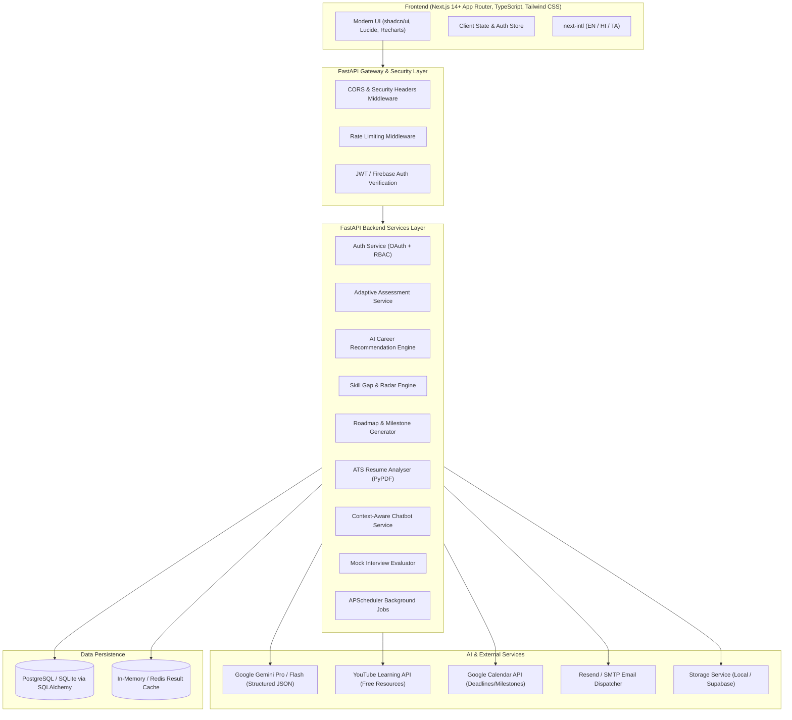

# PathFinder AI - System Architecture

## Architectural Highlights
- **Decoupled Architecture**: Clean contract between Next.js frontend and FastAPI backend via RESTful OpenAPI specifications.
- **Explainable AI Pipeline**: Every Gemini inference utilizes strictly validated Pydantic JSON schemas, defensive retry loops, prompt templates, and intelligent heuristics fallback when network or quota limits are reached.
- **Role-Based Access Control (RBAC)**: Distinct authorization scopes for students (`user`) and counselors/administrators (`admin`).
- **Resilient Offline-Ready Development**: Database layer transparently connects to PostgreSQL (Neon/Supabase) in production and falls back to SQLite in local/zero-config environments.

